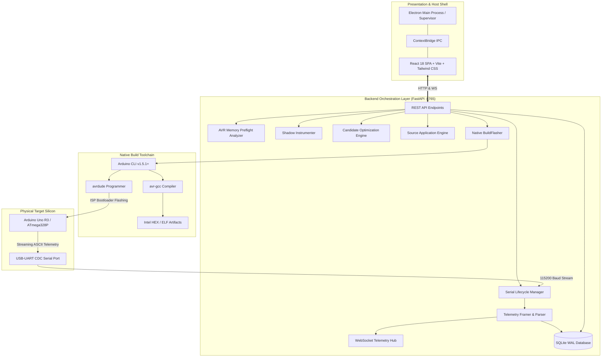
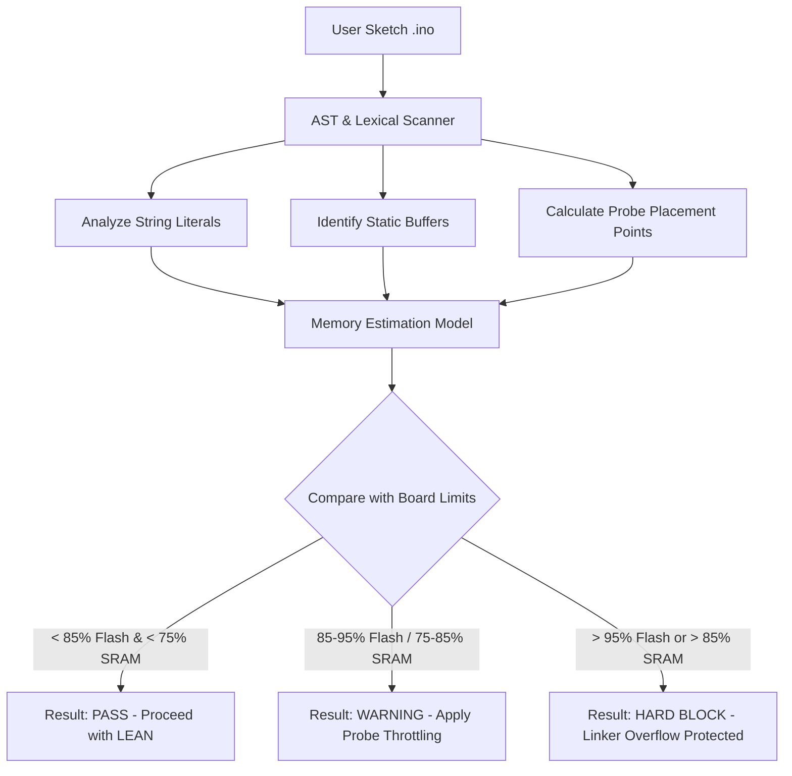
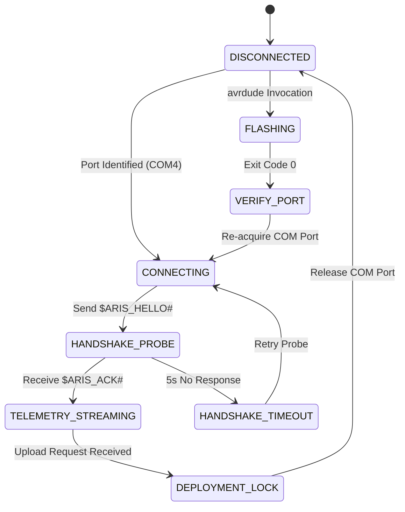
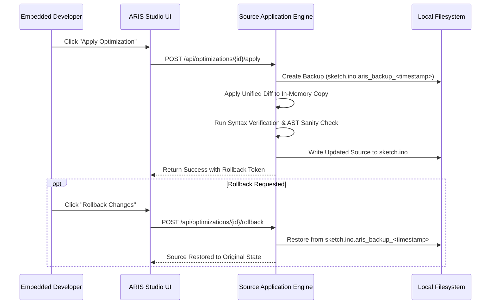

# ARIS Studio Architecture & Technical Specification

**Version:** 3.0.0  
**Target Hardware:** Atmel / Microchip AVR8 (ATmega328P @ 16 MHz, 5V)  
**Host Platforms:** Windows 10/11, Linux (x86_64), macOS (arm64/x86_64)  

---

## 1. Architectural Overview

ARIS Studio (Adaptive Runtime Intelligence System) is a multi-tier, hardware-in-the-loop firmware observability, static analysis, and closed-loop optimization platform. It is engineered specifically for deeply resource-constrained microcontrollers with no operating systems, no memory management units (MMUs), and strict kilobyte-scale memory boundaries.



---

## 2. Desktop Presentation Layer & Electron Supervisor

The host application combines an Electron shell with a high-performance React 18 Single Page Application.

### 2.1 Process Supervisor (`aris_desktop/electron/main.cjs`)
On Windows and UNIX environments, launching a coupled desktop application with an embedded Python backend presents reliability hazards: orphan processes, port collisions, zombie PIDs, and startup races.

The ARIS Electron supervisor implements an automated lifecycle state machine:

```
[APP START] ---> [PORT 8765 PROBE] ---> [RESOLVE PYTHON 3.11+] ---> [SPAWN BACKEND]
                        |                                                  |
                        v (if occupied)                                    v
                 [PID ARBITRATION]                                  [HEALTH POLL /health]
                 [KILL STALE PID]                                          |
                        |                                                  v (success)
                        +-----------------------------------------> [LOAD REACT UI]
```

Key supervisor capabilities:
1. **Port Conflict Resolution:** Prior to spawning Uvicorn, the supervisor runs `netstat -ano` (Windows) or `lsof -i :8765` (POSIX) to identify existing occupants of port 8765. If a previous ARIS instance was orphaned, its PID is terminated cleanly via `taskkill /F /PID`.
2. **Deterministic Python Discovery:** Tests five candidate locations in priority order:
   - System `PYTHON` environment variable.
   - Active virtual environment (`VIRTUAL_ENV/Scripts/python.exe`).
   - Project-local `.venv/Scripts/python.exe`.
   - Windows Registry / User Profile standard installations (`Python313`, `Python312`, `Python311`).
   - System `PATH` executable.
3. **IPC Health Telemetry:** Preload script exposes `window.arisSupervisor` through `contextBridge`, emitting backend state updates (`STARTING`, `ONLINE`, `RECOVERING`, `OFFLINE`) to the React UI.
4. **Clean Cascading Teardown:** Intercepts `app.on('before-quit')` to gracefully send `SIGTERM` / `SIGKILL` to the child Python tree, preventing lingering background processes.

---

## 3. Backend Orchestration Layer

The backend is built with **FastAPI** running atop **Uvicorn**, utilizing asynchronous I/O and non-blocking background threads.

### 3.1 REST & WebSocket Routers (`backend/api/`)
- `routes_health.py`: Probes host toolchain, Arduino CLI availability, connected serial ports, and memory status.
- `routes_firmware.py`: Accepts `.ino` sketches, executes preflight static analysis, generates shadow builds, and invokes the build toolchain.
- `routes_connection.py`: Scans serial ports, initiates handshake probes, and controls port acquisition.
- `routes_runs.py`: Manages discrete execution runs, queries historical samples, and exports run data.
- `routes_experiments.py`: Orchestrates multi-run closed-loop optimization experiments.
- `routes_optimization.py`: Generates AST candidates, ranks Pareto frontiers, and executes source code rollback.
- `routes_analysis.py`: Performs static complexity metrics (Halstead, cyclomatic complexity) and code analysis.

### 3.2 Database Persistence Engine (`backend/database/`)
ARIS uses **SQLite3** in **Write-Ahead Logging (WAL)** mode. WAL mode enables concurrent reader processes (FastAPI endpoints, analytics) while the telemetry ingestion thread continuously writes new sample points.

The schema comprises 17 fully relational tables:
1. `boards`: Hardware capabilities (Flash size, SRAM size, clock rate, FQBN).
2. `firmwares`: Tracked sketches, SHA-256 hashes, and original file paths.
3. `baselines`: Empirical performance benchmarks per firmware/board tuple.
4. `runs`: Individual execution sessions (baseline, candidate, or simulation).
5. `telemetry_samples`: Time-series samples (timestamp, loop time, jitter, SRAM watermark).
6. `findings`: Static AST optimization opportunities detected in sketches.
7. `optimizations`: Formal code transformations with diffs and Pareto rankings.
8. `experiments`: Multi-stage experiment manifests coordinating baseline vs candidate comparisons.
9. `hypotheses`: Predictive statements evaluated by experiments.
10. `predictions`: Anticipated resource deltas generated by the AI engine.
11. `validation_results`: Statistical hypothesis test outcomes (Mann-Whitney U, p-values).
12. `prediction_errors`: Discrepancies between predictions and physical measurements.
13. `measurement_outcomes`: Aggregated multi-variable experiment summaries.
14. `provenance_lineages`: Cryptographic provenance chains linking source lines to physical samples.
15. `experiment_manifests`: Complete reproducible experiment packages.
16. `experiment_memories`: Persistent cross-session knowledge base for candidate selection.
17. `sqlite_sequence`: Internal SQLite sequence tracking.

---

## 4. AVR Memory Preflight Analysis

On microcontrollers, dynamic memory allocators and profiling libraries easily trigger hard compiler failures or stack-heap collisions. The **AVR Memory Preflight Analyzer** (`backend/firmware/preflight_analyzer.py`) performs static inspection prior to build invocation:



### Mathematical Estimation Model
For target `arduino:avr:uno` (Flash: 32,256 B, SRAM: 2,048 B):
$$\text{Flash}_{\text{predicted}} = \text{Flash}_{\text{baseline}} + 1,234\text{ B (LEAN Runtime)} + (N_{\text{probes}} \times 18\text{ B})$$
$$\text{SRAM}_{\text{predicted}} = \text{SRAM}_{\text{baseline}} + 14\text{ B (Static State)}$$

If $\text{Flash}_{\text{predicted}} > 32,256$ or $\text{SRAM}_{\text{predicted}} > 1,740$ (85% threshold, reserving 308 bytes for stack growth), the preflight gate halts compilation and displays actionable remediation in the UI.

---

## 5. Sketch Shadow Instrumentation Engine

To ensure user sketches are never damaged during testing, the **Shadow Instrumenter** (`backend/instrumentation/sketch_instrumenter.py`) creates an isolated shadow workspace:

```
C:\Users\<user>\AppData\Local\Temp\aris_build_<hash>\
├── sketch_name.ino          # Instrumented shadow copy
├── aris_runtime.h           # Embedded telemetry header
├── aris_runtime.cpp         # Embedded telemetry implementation
└── aris_config.h            # Compile-time profile configuration
```

### Source Transformation Rules:
1. **Header Injection:** Inserts `#include "aris_runtime.h"` at the sketch head.
2. **Runtime Initialization:** Detects `setup()` entry and prepends `aris_runtime.init(115200);`.
3. **Loop Probe Insertion:** Surrounds `loop()` contents with cycle-accurate timing probes:
   ```cpp
   void loop() {
     aris_runtime.probe_enter(0);
     // Original user code
     aris_runtime.probe_exit(0);
     aris_runtime.heartbeat();
   }
   ```
4. **Function Interception:** Wraps performance-critical user routines with discrete probe IDs.

---

## 6. Embedded Telemetry Runtime Architecture

The embedded runtime (`embedded/runtime/`) is a standalone C++ library compiled directly into the microcontroller binary.

```
+---------------------------------------------------------------------------------------------------+
|                                 ATmega328P SRAM MEMORY MAP                                        |
+---------------------------------------------------------------------------------------------------+
| 0x0100 +---------------------------------------------------------------------------------------+ |
|        | .data Section (Initialized Globals)                                                   | |
|        | User Globals + ARIS Static State (14 bytes total in LEAN profile)                     | |
|        +---------------------------------------------------------------------------------------+ |
|        | .bss Section (Uninitialized Globals)                                                  | |
|        | Cleared on reset                                                                      | |
|        +---------------------------------------------------------------------------------------+ |
|        | HEAP (Grows Downward) -> [ZERO DYNAMIC ALLOCATION ALLOWED IN ARIS RUNTIME]             | |
|        |                                                                                       | |
|        | . . . . . . . . . . . . . . FREE SRAM WATERMARK ZONE . . . . . . . . . . . . . . . . | |
|        |                                                                                       | |
|        | STACK (Grows Upward from RAMEND) <- Monitored by SP Register Check                    | |
| 0x08FF +---------------------------------------------------------------------------------------+ |
+---------------------------------------------------------------------------------------------------+
```

### 6.1 LEAN vs FULL Profile Specifications

| Metric / Feature | LEAN Profile (Default) | FULL Profile |
| :--- | :--- | :--- |
| **Static Flash ROM Footprint** | **1,234 bytes** | 3,420 bytes |
| **Static SRAM Allocation** | **14 bytes** | 88 bytes |
| **Heap Consumption** | **0 bytes** | 0 bytes |
| **Timer Hardware Used** | Timer1 (16-bit register direct access) | Timer1 + Timer2 |
| **Sampling Mechanism** | Periodic prescaled serial frame | Event-driven packet queue |
| **Stack Safety Monitoring** | Stack Pointer register read (`SP`) | 16-byte pattern watermark array |

### 6.2 Cycle-Accurate Probe Mechanism
On AVR8, calling `micros()` introduces variable division and interrupt latency (~3.5 µs overhead). ARIS bypasses the Arduino core functions and reads hardware timer registers directly:
```cpp
inline void ArisRuntime::probe_enter(uint8_t probe_id) {
  // Read 16-bit Timer1 counter (1 cycle at 16 MHz = 62.5 ns)
  _t_start[probe_id] = TCNT1;
}

inline void ArisRuntime::probe_exit(uint8_t probe_id) {
  uint16_t t_end = TCNT1;
  _elapsed_cycles[probe_id] = (t_end >= _t_start[probe_id]) 
    ? (t_end - _t_start[probe_id]) 
    : (0xFFFF - _t_start[probe_id] + t_end);
}
```

---

## 7. Serial Lifecycle & Handshake Protocol

Serial port management on Windows requires strict synchronization to prevent deployment lockouts.



### 7.1 Serial Packet Framing Specifications

| Packet Type | Frame Syntax | Description |
| :--- | :--- | :--- |
| **Hello Probe (Host)** | `$ARIS_HELLO#` | Host broadcasts probe to trigger runtime acknowledgment. |
| **Handshake ACK (MCU)**| `$ARIS_ACK,v3.0.0,p2,uno,atmega328p,avr8,16000000,LEAN#` | Firmware announces version, MCU, clock speed, and mode. |
| **Boot Announcement** | `$ARIS_BOOT,uno,atmega328p,16000000#` | Emitted immediately by firmware in `setup()` upon hardware reset. |
| **Telemetry Sample** | `$ARIS_SAMPLE,seq=104,loop_ns=62500,jit_ns=800,sram_free=1582#` | Periodic runtime performance sample. |

---

## 8. Candidate Generation & Pareto Optimization Engine

The optimization engine (`backend/optimization/candidate_generation_engine.py`) detects inefficient patterns and creates candidate transformations:

```
+-------------------------------------------------------------------------------------------------+
|                                    OPTIMIZATION PIPELINE                                        |
+-------------------------------------------------------------------------------------------------+
| 1. AST Code Scan       | Parser extracts syntax tree & identifies candidate patterns.            |
| 2. Candidate Creation  | Generates unified diffs and metadata models (CandidateModels).         |
| 3. Preflight Check     | Evaluates predicted memory and execution changes.                      |
| 4. Shadow Compilation  | Builds candidate firmware via Arduino CLI in shadow directory.         |
| 5. Hardware Deployment | Flashes candidate binary to physical target board.                     |
| 6. Telemetry Capture   | Records 10,000 physical benchmark iterations.                          |
| 7. Pareto Ranking      | Evaluates speedup vs flash/SRAM delta along Pareto frontier.           |
| 8. Promotion/Rollback  | User accepts or rejects; accepted patches applied via Source Engine.   |
+-------------------------------------------------------------------------------------------------+
```

---

## 9. Source Application & Rollback Engine

The **Source Application Engine** (`backend/optimization/source_application_engine.py`) guarantees sketch preservation:



---

## 10. Research Provenance & Evidence Architecture

Every experiment conducted in ARIS Studio is captured as an immutable, self-contained JSON evidence package (e.g., `reports/EXP_PHYS_001_evidence_package.json`).

### Provenance Structure:
- **`experiment`**: Unique ID (`EXP-PHYS-001`), timestamp, title, and decision (`ACCEPTED`).
- **`hardware`**: Microcontroller architecture, clock rate, memory limits, port, and baud rate.
- **`candidate`**: Finding ID, transformation ID, source line, and before/after diff.
- **`build_artifacts`**: Toolchain version, compiler flags, FQBN, and exact Flash/SRAM allocation bytes.
- **`metrics`**: Observed statistical distributions (mean, median, stddev, IQR, min, max) across 10,000 physical cycles.
- **`statistical_validation`**: Mann-Whitney U test statistic, p-value ($p < 0.0001$), and Cohen's d effect size ($d = 2.45$).

---
*ARIS Studio Technical Specification — Designed for Mathematical Rigor and Hardware Reliability.*
